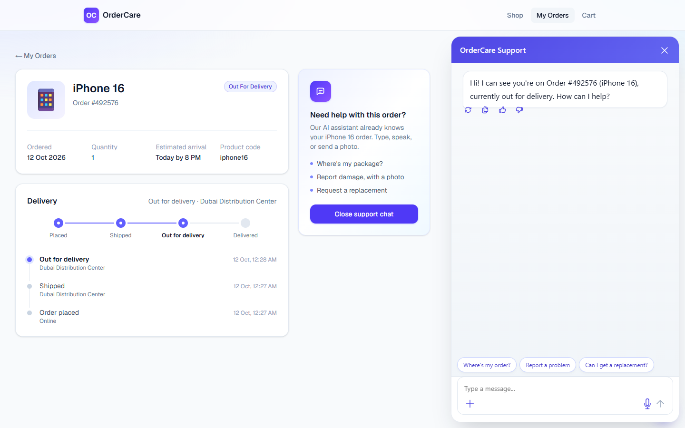
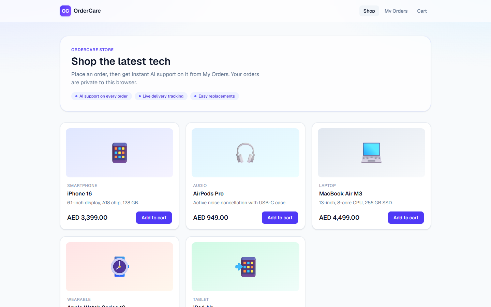
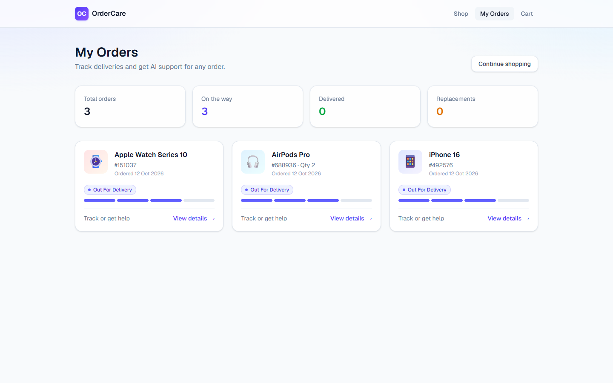
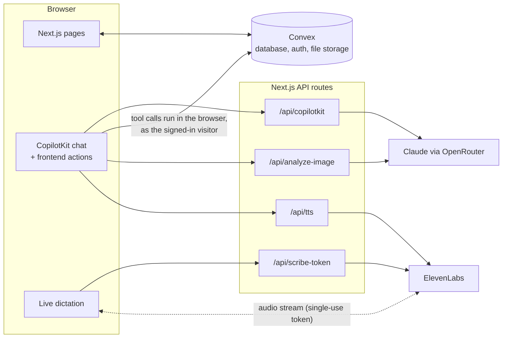

# OrderCare

**AI customer support that already knows your order.**

OrderCare puts a support agent directly on the order page of an online store. The agent receives the order the customer is looking at, so the customer never has to type an order number or explain which product they mean. They ask "where's my package?", send a photo of a cracked screen, or just speak, and the agent tracks the delivery, opens a support case, checks eligibility and offers a replacement, which the customer confirms with one click.

**Live demo: [ai-tinkerers-hackathon.vercel.app](https://ai-tinkerers-hackathon.vercel.app)**

Built for the AI Tinkerers hackathon.



## Try it in two minutes

No sign-up is needed. Each browser automatically gets its own private account.

1. Open the [live demo](https://ai-tinkerers-hackathon.vercel.app), add an **iPhone 16** to the cart and place the order.
2. Go to **My Orders**. Over about 90 seconds the order moves from placed to shipped, out for delivery and delivered.
3. Open the order and click **Chat with OrderCare**:
   - Ask **"Where's my package?"** to get a live tracking card.
   - Say **"The screen arrived cracked"** and attach a photo. The agent describes the damage, opens a support case and checks whether the order is eligible for a replacement.
   - Agree to a replacement, then click **Confirm**. Nothing is created until you do.
4. Click the **mic** and speak. Your words appear in the box as you talk, and nothing is sent until you press Enter.

Open the site in a private window: it starts with an empty account and can't see your orders.



## Features

| | |
| --- | --- |
| **Order-aware agent** | The chat receives the current order, product and status, and never asks the customer for them. |
| **Tracking** | Live status, location and ETA, shown as a card in the chat and as a timeline on the order page. |
| **Damage reports with photos** | Photos are stored with the support case and checked by a vision model. It uses cautious wording ("appears consistent with") rather than a diagnosis. |
| **Replacements with human confirmation** | The agent can prepare a replacement, but only the customer's click creates it. The server rejects duplicate requests and products that can't be replaced. |
| **Live voice dictation** | Speech streams into the text box in real time (ElevenLabs realtime speech-to-text). The customer can edit before sending. |
| **Spoken replies** | Every agent reply is read aloud (ElevenLabs text-to-speech). |
| **Private sessions, no login** | Each browser is signed in anonymously, and visitors only see orders they placed. |
| **Shop and checkout** | A small catalog, cart and demo checkout (no payment), so testers can create their own orders. |



## How it works



- **The agent's tools run in the browser.** CopilotKit frontend actions (`getTrackingInfo`, `reportProductIssue`, `confirmReplacement`) call Convex with the visitor's own session. The agent can therefore only reach data that visitor is allowed to see, and every Convex function checks order ownership on the server.
- **Each capability is a separate Convex module** (`tracking`, `supportCases`, `returns`). Each one reads only the data its task needs.
- **Identity comes from the server, never the client.** `convex/customer.ts` resolves the customer from the auth token. No function accepts a customer ID as an argument.
- **The ElevenLabs API key stays on the server.** For live dictation, the browser gets a single-use, 15-minute token from `/api/scribe-token` and streams microphone audio directly to ElevenLabs with it.
- **Delivery is simulated.** Placing an order schedules Convex functions that move it forward every 30 seconds. They stop automatically if a replacement is requested.

## Agent guardrails

The system prompt is in [lib/prompt.ts](lib/prompt.ts), and the server enforces the important rules as well:

- The agent must not invent tracking details, eligibility or outcomes. It only reports what a tool returned.
- It must not claim an action succeeded unless the tool call did.
- A replacement needs the customer's explicit agreement in the chat **and** a click on **Confirm**.
- Photo analysis uses cautious language, never a definitive diagnosis.
- Server-side checks reject another customer's order, a second replacement for the same order, and replacements for products that don't offer them.

## Tech stack

| Layer | Technology |
| --- | --- |
| Frontend | Next.js 16 (App Router), React 19, Tailwind CSS 4 |
| Agent UI and actions | CopilotKit |
| Language and vision model | Anthropic Claude via OpenRouter (default `anthropic/claude-sonnet-5.5`) |
| Voice | ElevenLabs: realtime speech-to-text (`scribe_v2_realtime`) and text-to-speech |
| Backend, database, auth, files | Convex, with Convex Auth (anonymous provider) |
| Hosting | Vercel + Convex Cloud |

## Run it locally

You need Node.js 20 or newer (22 recommended) and accounts with [Convex](https://convex.dev), [OpenRouter](https://openrouter.ai) and, for voice, [ElevenLabs](https://elevenlabs.io).

1. **Install dependencies**

   ```bash
   npm install
   ```

2. **Start Convex.** The first run asks you to log in and create or choose a project. It writes `CONVEX_DEPLOYMENT` and `NEXT_PUBLIC_CONVEX_URL` to `.env.local`. Leave it running.

   ```bash
   npx convex dev
   ```

3. **Add your API keys** to `.env.local`:

   ```bash
   OPENROUTER_API_KEY=sk-or-...
   ELEVENLABS_API_KEY=sk_...        # voice only; use the full key starting with sk_, not the key ID
   # Optional:
   # OPENROUTER_MODEL=anthropic/claude-sonnet-5.5   # must support images
   # ELEVENLABS_VOICE_ID=...
   ```

4. **Set up sign-in** (once per Convex deployment). This generates the signing keys and sets them, along with `SITE_URL`, on your dev deployment:

   ```bash
   npm run setup:auth
   ```

5. **Load the product catalog.** This also clears any existing orders, support cases and replacements.

   ```bash
   npm run seed
   ```

6. **Start the app** in a second terminal and open <http://localhost:3000>:

   ```bash
   npm run dev
   ```

## Deploy

The live demo runs on Vercel with a Convex production deployment.

1. In the Convex dashboard, create a **Production** deployment for the project. Under **Settings**, generate a **production deploy key** with the `deployment:deploy` permission.
2. Import the repository into Vercel. Don't add Vercel's Convex integration: it creates a separate Convex project. Then:
   - Set the **Build Command** to `npx convex deploy --cmd 'npm run build'`. Each deploy then pushes the Convex functions and points the site at production.
   - Add the environment variables `CONVEX_DEPLOY_KEY`, `OPENROUTER_API_KEY` and `ELEVENLABS_API_KEY`.
3. After the first deploy, set up sign-in on production and load the catalog:

   ```bash
   node scripts/setup-auth.mjs --prod --site-url https://your-app.vercel.app
   npx convex run seed:seed --prod
   ```

From then on, every push to `main` redeploys both the site and the backend.

**Before sharing the link:** set a spending limit on the OpenRouter key and check your ElevenLabs credits. Anyone with the URL can chat with the agent and use voice.

## Project layout

```
app/
  page.tsx                    Shop
  cart/page.tsx               Cart and checkout
  orders/page.tsx             My Orders
  order/[orderId]/page.tsx    Order details, delivery timeline, support chat
  api/copilotkit/             Agent runtime (OpenRouter)
  api/analyze-image/          Vision check for uploaded photos
  api/scribe-token/           Single-use token for live speech-to-text
  api/tts/                    Text-to-speech
components/
  SupportPanel.tsx            Agent context, tools and photo upload
  ChatInput.tsx               Chat input with the live-dictation mic
  ReplacementConfirmCard.tsx  Confirm/cancel step for replacements
  SpokenReplies.tsx           Reads agent replies aloud
  OrderProgress.tsx           Delivery progress tracker
  cards.tsx                   Tracking and eligibility cards
  SiteHeader.tsx              Navigation and cart count
lib/
  prompt.ts                   Agent instructions and guardrails
  useLiveTranscription.ts     Microphone capture and realtime transcription
  cart.ts                     Per-browser cart
  shop.ts                     Formatting and status helpers
  openrouter.ts               OpenRouter client and model setting
convex/
  schema.ts                   Tables: orders, products, supportCases, replacements, trackingEvents (+ auth)
  auth.ts, auth.config.ts     Convex Auth with the anonymous provider
  customer.ts                 Current customer and order-ownership checks
  orders.ts                   Orders, checkout and simulated delivery
  products.ts                 Product catalog
  tracking.ts                 Tracking status and history
  supportCases.ts             Support cases and photo uploads
  returns.ts                  Eligibility and replacements
  seed.ts                     Loads the catalog (CLI only)
scripts/
  setup-auth.mjs              Generates and sets the sign-in keys
```

## Limitations

- **Sessions belong to one browser.** Clearing site data, using a private window or switching devices starts a new, empty account.
- **Checkout is a demo.** No payment is taken, and delivery is simulated.
- **Replacements aren't tied to delivery.** The server allows a replacement before an order has been delivered.
- **Live dictation has only been tested in Brave.** It needs microphone permission and a browser with Web Audio worklets, which all current major browsers have.
